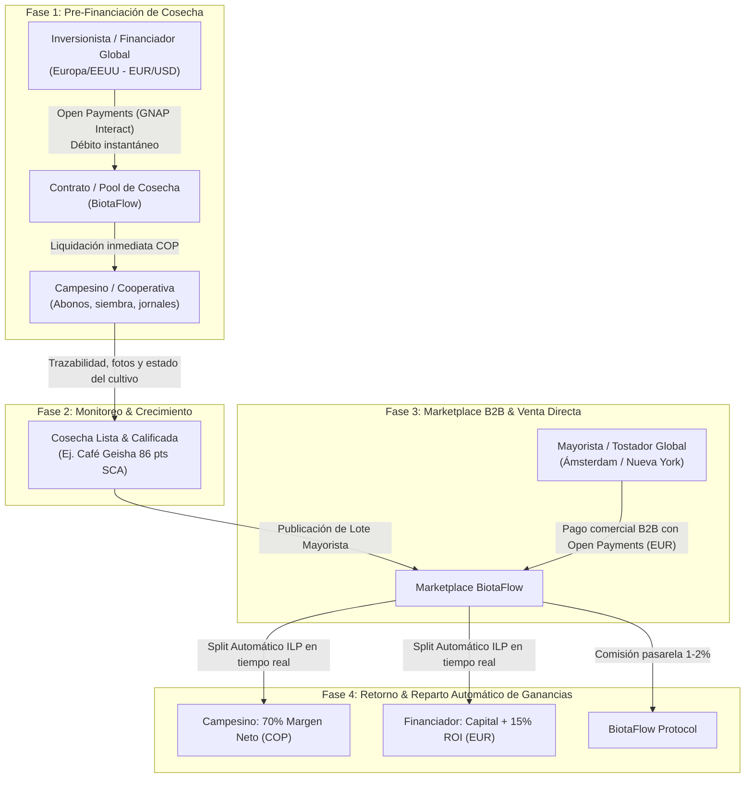

# 🌿 BiotaFlow: Modelo Agro-Financiero de Ciclo Cerrado (ReFi & Open Payments)

Este documento detalla el modelo de negocio, el flujo de valor de ciclo cerrado y las Historias de Usuario con base en la tecnología **Open Payments (Interledger Protocol - ILP)** y el estándar **GNAP**.

---

## 1. El Ciclo de Negocio en 4 Fases

---

## 2. Historias de Usuario (User Stories)

### Rol 1: Financiador / Inversionista Global (Europa / EE.UU.)
* **US-F1 (Descubrimiento y Rendimiento Proyectado):**
  * *Como* inversionista en Alemania,
  * *quiero* explorar proyectos agrícolas con ficha técnica clara: monto requerido en COP, plazo de cosecha (ej. 6 meses) y retorno esperado estimado (ej. Capital + 12% a 15% en EUR),
  * *para* elegir qué cultivo o cooperativa respaldar con capital productivo.
* **US-F2 (Inversión Transfronteriza en 1 Clic con GNAP):**
  * *Como* inversionista con billetera Open Payments (Rafiki) en EUR/USD,
  * *quiero* autorizar el desembolso de mi inversión con cotización garantizada EUR $\to$ COP sin cobros ocultos de intermediarios SWIFT,
  * *para* que mi dinero llegue íntegro e instantáneo al productor en Colombia.
* **US-F3 (Recepción Automática de Rendimientos en Billetera):**
  * *Como* financiador,
  * *cuando* el mayorista compre el lote de café/cacao meses después,
  * *quiero* recibir automáticamente mi capital más la ganancia acordada directamente en mi Payment Pointer en EUR,
  * *sin* tener que solicitar retiros manuales ni pagar comisiones de liquidación.

---

### Rol 2: Campesino / Cooperativa Productora (Colombia)
* **US-P1 (Publicación de Campaña de Cosecha):**
  * *Como* productor de café o líder de cooperativa en Boyacá,
  * *quiero* solicitar \$10.000.000 COP para abono orgánico y pago de recolectores, ofreciendo como garantía el 100% del lote cosechado,
  * *para* apalancar la producción sin endeudarme con préstamos informales ("gota a gota") o bancos tradicionales con tasas del 35% EA.
* **US-P2 (Desembolso Instantáneo en Moneda Local):**
  * *Como* campesino,
  * *quiero* recibir los aportes de los financiadores internacionales convertidos directamente a COP en mi cuenta local,
  * *para* disponer de liquidez inmediata para comprar insumos.
* **US-P3 (Liquidación de Cosecha y Pago de Ganancia Justa):**
  * *Como* productor,
  * *cuando* se vende mi lote cosechado en el marketplace,
  * *quiero* recibir mi margen de ganancia líquida en COP de inmediato sin esperas a 60 o 90 días,
  * *para* reinvertir en la siguiente cosecha y mejorar la calidad de vida de mi familia.

---

### Rol 3: Mayorista / Exportador / Comprador Internacional (B2B)
* **US-M1 (Catálogo B2B con Trazabilidad de Origen):**
  * *Como* tostador de café en Países Bajos,
  * *quiero* comprar lotes que indican qué campesino lo cultivó, qué inversionista lo financió y su perfil de taza/calidad,
  * *para* comercializar café ético de origen con historia y valor agregado.
* **US-M2 (Pago B2B con Liquidación y Split Instantáneo):**
  * *Como* comprador mayorista,
  * *quiero* pagar el lote completo (ej. 3.500 EUR) mediante Open Payments,
  * *para* que el protocolo distribuya automáticamente el pago: el capital + ROI al financiador, el beneficio al campesino y la comisión a la plataforma, en una sola operación atómica.

---

## 3. Ideas de Alto Valor para Destacar en la Hackathon

1. **"The Split Payment" (La Joya de la Corona ILP):**
   * El jurado evalúa casos de uso avanzados de Open Payments. Cuando el mayorista compra el café, el backend de BiotaFlow no se queda con el dinero para transferirlo días después: usa Open Payments para disparar los pagos salientes de liquidación (**Outgoing Payments**) en milisegundos hacia el campesino (COP) y hacia el financiador (EUR).
2. **Micro-Trazabilidad de la Inversión:**
   * Mostrar en la tarjeta del lote: *"Este café fue financiado en etapa de floración por Sarah (Berlín) y cultivado por Don Pedro (Boyacá)"*. Transparencia radical.
3. **Métrica de Impacto ReFi:**
   * Mostrar el ahorro de comisiones bancarias tradicionales: *"Se ahorró un 9.4% en intermediarios bancarios gracias a Interledger Protocol"*.
