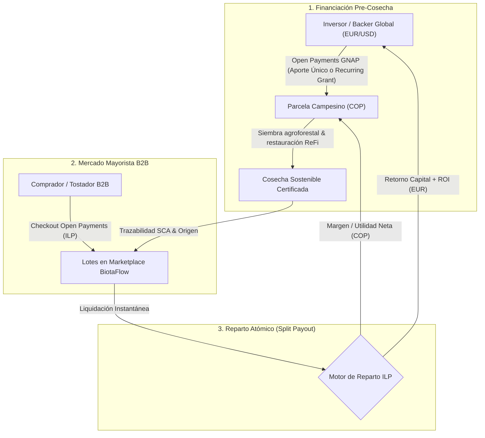
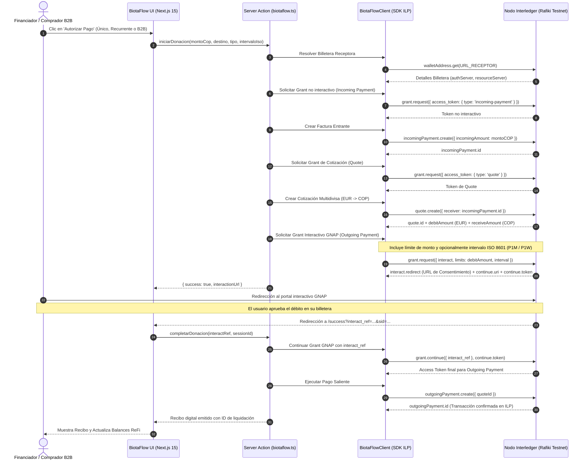
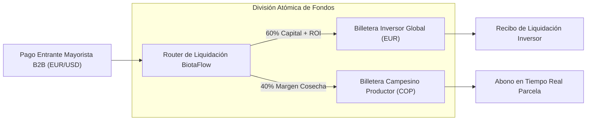

# BiotaFlow: Infraestructura ReFi y eCommerce B2B con Open Payments (ILP)

> **Documento Oficial de Arquitectura Técnica y Entrega para Jurados**  
> **Proyecto:** BiotaFlow  
> **Hackathon:** Open Payments Hackathon  
> **Estándar:** Interledger Protocol (ILP) & Open Payments Specification (GNAP / RFC 9421)  

---

## 1. Resumen Ejecutivo de la Presentación (Pitch Framework)

### A. The Challenge (El Desafío)
* **Exclusión Financiera Rural:** Los pequeños agricultores agroforestales y regenerativos en Colombia operan en moneda local (**COP**), excluidos de créditos formales o atados a tasas de interés predatorias.
* **Fricción Transfronteriza:** Conectar capital internacional (**EUR/USD**) con el campo colombiano mediante la banca tradicional (SWIFT) toma entre 3 y 5 días hábiles y destruye entre el **8% y el 12%** del dinero en intermediarios y comisiones cambiarias.
* **Ausencia de Rieles Programables y Recurrentes:** Las pasarelas de pago convencionales son jardines cerrados que no admiten patrocinios periódicos directos (*Recurring Grants*) ni liquidación automatizada y dividida (*Split Payouts*) entre inversores y productores al cosechar.

### B. The User (El Usuario)
1. **Productor Agroforestal (Campesino):** Necesita capital de trabajo para insumos bioorgánicos y restauración sin endeudarse, y cobro directo e instantáneo por sus cosechas (ej. café bajo sombra en Boyacá, cacao fino en Huila).
2. **Financiador Global (ReFi Backer):** Ciudadanos o fondos en Europa/EE.UU. que desean patrocinar la transición ecológica mediante aportes únicos o suscripciones mensuales transparentes con auditoría ReFi (GPS, altitud, % dosel de sombra y métricas de $\text{CO}_2$).
3. **Comprador Mayorista B2B (Tostador / Distribuidor):** Empresas internacionales que adquieren cosechas con trazabilidad de origen y liquidan de forma directa con Open Payments.

### C. The Solution (La Solución: BiotaFlow)
Plataforma descentralizada de finanzas regenerativas (ReFi) y marketplace B2B construida sobre Next.js 15 que cierra el ciclo económico en cuatro fases:
1. **Financiación Pre-Cosecha (Crowdfarming):** Aportes únicos o donaciones recurrentes automáticas.
2. **Auditoría y Trazabilidad:** Monitoreo agronómico en tiempo real de la parcela.
3. **Mercado Mayorista B2B:** Catálogo de lotes con puntaje de calidad (SCA) y pre-financiación trazada.
4. **Reparto Atómico Automatizado (Split Payouts):** Al vender el lote, el pago enrutable de Open Payments divide el capital: retorna el principal + ROI al inversor internacional en EUR y liquida el margen en COP al campesino.

### D. How Open Payments Was Used (Uso del Protocolo)
* **Flujo E2E GNAP (RFC 9421):** Ciclo completo de 8 fases (`walletAddress.get` $\rightarrow$ `grant.request` $\rightarrow$ `incomingPayment.create` $\rightarrow$ `quote.create` $\rightarrow$ `interact` $\rightarrow$ `grant.continue` $\rightarrow$ `outgoingPayment.create`).
* **Recurring Grants con ISO 8601:** Parámetro `interval` (`R/2026-10-01T00:00:00Z/P1M` mensual y `P1W` semanal) para suscripciones de apoyo ecológico que se renuevan automáticamente sin firma manual reiterada.
* **Liquidación Multidivisa en Tiempo Real (EUR $\rightarrow$ COP):** Cotizaciones instantáneas mediante el conector de Rafiki.
* **Firmas Criptográficas HTTP:** Llaves asimétricas Ed25519 custodiadas estrictamente en el backend.

### E. Key Learnings (Aprendizajes Clave)
1. **GNAP es superior a OAuth para transacciones financieras:** El modelo de concesiones (*Grants*) desacopla identidad de consentimiento monetario, permitiendo límites de monto, expiración e intervalos recurrentes sin exponer llaves privadas.
2. **Interledger democratiza las microfinanzas rurales:** La conmutación de paquetes de ILP elimina los costes fijos de transferencias internacionales, haciendo viables aportes desde \$10 o \$20 USD directos al campesino.
3. **Manejo de Idempotencia en Frameworks Modernos:** Resolver el ciclo de vida de tokens de un solo uso (*single-use nonces*) en callbacks asíncronos de React 19 y Next.js 15.

---

## 2. Diagramas de Arquitectura y Flujos

### Diagrama 1: Modelo de Negocio Circular (BiotaFlow)



---

### Diagrama 2: Secuencia Técnica de Open Payments & GNAP en BiotaFlow



---

### Diagrama 3: Arquitectura del *Split Payout* Automatizado



---

## 3. Mapeo de Funciones de BiotaFlow con Open Payments SDK

| Función en `BiotaFlow` | Método Oficial Open Payments | Propósito en el Modelo de Negocio |
| :--- | :--- | :--- |
| **`resolverBilletera`** | `client.walletAddress.get()` | Valida el Payment Pointer del campesino o de la tienda mayorista y obtiene los endpoints del servidor GNAP. |
| **`crearFacturaEntrante`** | `client.incomingPayment.create()` | Genera la orden de cobro en Pesos Colombianos (COP) para la parcela o el lote B2B. |
| **`crearCotizacion`** | `client.quote.create()` | Calcula la tasa de cambio en tiempo real y el monto que saldrá de la billetera del financiador en EUR. |
| **`solicitarGrantInteractivo`** | `client.grant.request({ interact, interval })` | Negocia con GNAP el permiso de débito; soporta **Aportes Únicos** o **Recurring Grants** (ISO 8601 `P1M`). |
| **`finalizarConsentimiento`** | `client.grant.continue({ interact_ref })` | Canjea el código de autorización devuelto por Rafiki por el token final de liquidación. |
| **`ejecutarPagoSaliente`** | `client.outgoingPayment.create()` | Despacha los paquetes de valor por la red Interledger para liquidar la transacción de forma irrevocable. |

---

## 4. Ingeniería de Seguridad y Retos Técnicos Resueltos

### A. Firmas Criptográficas RFC 9421 y Desacoplamiento de CORS
* **Problema:** El estándar Open Payments requiere firmar digitalmente cada cabecera HTTP usando pares de llaves asimétricas **Ed25519**. Si el frontend intentaba invocar a Rafiki directamente con JavaScript:
  1. El navegador bloqueaba las llamadas por directivas de **CORS**.
  2. Exponer llaves privadas en el bundle de JavaScript violaba los principios de seguridad de la Web.
* **Solución:** Implementación de **Next.js Server Actions (`'use server'`)**. El frontend únicamente solicita intenciones de pago; la firma criptográfica, la lectura de claves `.pem` y la comunicación con el servidor GNAP ocurren de forma hermética de Servidor a Servidor.

### B. Cerrojo de Idempotencia contra React 19 StrictMode (Single-Use Nonces)
* **Problema:** En Next.js y React 19 en modo desarrollo, los componentes ejecutan el ciclo `useEffect` dos veces seguidas (*StrictMode*). El parámetro `interact_ref` devuelto por Rafiki es un **token criptográfico de un solo uso**. La primera llamada ejecutaba el pago correctamente, pero la segunda llamada inmediata enviaba el mismo token ya consumido, provocando un error `400 Bad Request: interaction reference already consumed` que sobreescribía la interfaz mostrando un falso error.
* **Solución:** Implementación de un cerrojo de ejecución mutable mediante `useRef(false)` en [`app/success/page.tsx`](file:///home/danivargashermosa/web3/hackayon_openPayment/app/success/page.tsx), garantizando que el canje del grant se despache estrictamente una única vez:
  ```typescript
  const hasExecutedRef = useRef(false);

  useEffect(() => {
    if (hasExecutedRef.current) return;
    hasExecutedRef.current = true;
    completarDonacion(interactRef, sessionId);
  }, [searchParams]);
  ```

### C. Almacén de Estado Asíncrono de Sesiones GNAP
* En Next.js App Router, las Server Actions corren en worker threads independientes.
* Implementamos un gestor de sesión temporal con TTL de 15 minutos en `.next/cache/openpayments-gnap-state/` para preservar el `continue.uri`, `continue.token` y cotizaciones entre el inicio de la transacción y el callback de redirección sin exponer datos sensibles en cookies del navegador.

---

## 5. Especificación de Endpoints y Billeteras en Rafiki Testnet

* **Billetera Emisora (Donante / Mayorista):**
  `$ilp.interledger-test.dev/225f757` (Moneda: `EUR`, assetScale: `2`)
* **Billetera Receptora (Parcelas / Productores):**
  `$ilp.interledger-test.dev/pagos-entrada` (Moneda: `COP`, assetScale: `2`)
* **Servidor de Autorización GNAP:**
  `https://auth.interledger-test.dev/`
* **Estándar de Recurrencia:**
  ISO 8601 Repeater Syntax (`R/{startTime}/{interval}`) ej. `R/2026-10-01T00:00:00Z/P1M`
