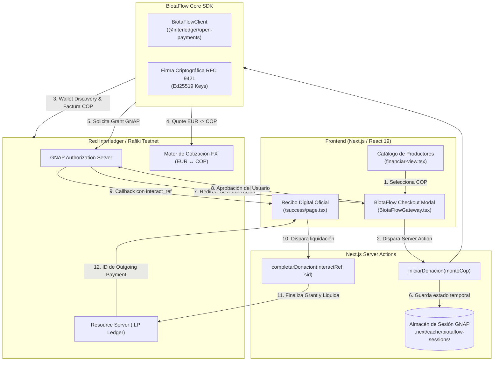

# BiotaFlow: Infraestructura de Pagos Transfronterizos con Open Payments (ILP)

> **Documento de Arquitectura y Resumen Técnico de Producto**  
> **Proyecto:** Biota Protocol / BiotaFlow  
> **Módulo:** BiotaFlow Gateway  
> **Estándar:** Interledger Protocol (ILP) & Open Payments Specification  

---

## 1. Visión y Resumen Ejecutivo del Producto

### El Problema
Los agricultores regenerativos en Colombia operan en moneda local (**COP**), mientras que los donantes, inversionistas de impacto y entidades internacionales que financian proyectos ReFi (Finanzas Regenerativas) manejan monedas duras (**EUR / USD**).
- Las pasarelas bancarias tradicionales cobran altas comisiones cambiarias (spread FX), tardan días en liquidar y exigen bancarización tradicional que excluye a la ruralidad.
- Las plataformas cripto nativas exigen al campesino entender de gas, puentes, swaps y llaves privadas en EVM para poder comprar insumos agrícolas.

### La Solución: BiotaFlow
**BiotaFlow** es una pasarela de pago transfronteriza embebida en la dApp **BiotaFlow**. Permite que un donante internacional financie directamente a un productor rural:
1. El donante autoriza el pago desde su billetera en **Euros (EUR)**.
2. La red **Interledger (ILP)** ejecuta el intercambio de divisas en tiempo real.
3. El productor campesino recibe instantáneamente **Pesos Colombianos (COP)** en su cuenta vinculada, sin fricción cripto ni intermediarios financieros tradicionales.

---

## 2. Arquitectura del Sistema

---

## 3. Especificación Técnica por Componentes

### A. Capa de Seguridad Criptográfica (RFC 9421)
- Cada solicitud a la API de Open Payments es firmada usando pares de llaves asimétricas **Ed25519**.
- Las llaves privadas (`private.pem`) residen estrictamente en el entorno del servidor y están bloqueadas contra Git (`.gitignore`).
- Las llaves públicas están registradas en el JWKS (*JSON Web Key Set*) del Payment Pointer del emisor.

### B. SDK Modular (`biotaflow-sdk/core/BiotaFlowClient.ts`)
Construido con programación orientada a objetos (OOP) sobre `@interledger/open-payments`:
- `getWalletDetails(url)`: Descubre dinámicamente los servidores `authServer` y `resourceServer`, así como el `assetCode` y `assetScale`.
- `createChargeInvoice(receivingWalletUrl, amount)`: Genera un `Incoming Payment` en COP en el receptor.
- `createQuoteForPayment(invoiceUrl)`: Calcula la tasa de cambio garantizada entre EUR y COP.
- `requestInteractivePaymentGrant(quote, redirectUrl)`: Negocia permisos interactivos bajo el estándar **GNAP**.
- `finalizeInteractiveGrant(continueUri, continueToken, interactRef)`: Canjea el token interactivo por el token de acceso definitivo.
- `executePayment(quoteId, accessToken)`: Dispara la transferencia saliente (`Outgoing Payment`) en el ledger ILP.

### C. Server Actions y Persistencia (`app/actions/biotaflow.ts`)
- **Aislamiento Multi-Worker**: En entornos modernos como Next.js, cada Server Action se ejecuta en worker threads aislados. Implementamos un almacén seguro con TTL de 15 minutos en `.next/cache/biotaflow-sessions/` para compartir tokens de autorización y montos cotizados sin exponerlos en cookies que los navegadores bloquean tras redirecciones cross-site.
- **Idempotencia**: Garantiza que un token de autorización GNAP (de un solo uso) no se intente liquidar dos veces.

### D. Experiencia de Usuario (UI/UX de Hackathon)
- **Modal de Checkout BiotaFlow**: Interfaz con diseño estilo Stripe/Wompi, mostrando montos formateados en moneda local (`$50.000 COP`) y el Payment Pointer de origen.
- **Pantalla de Éxito y Recibo Digital (`app/success/page.tsx`)**:
  - Protección contra doble ejecución de React 19 `StrictMode` mediante `useRef(false)`.
  - Desglose de auditoría: monto acreditado en COP, monto debitado en EUR, tipo de cambio ILP, productor beneficiario y fecha.
  - Copiado rápido de identificador de transacción ILP y botón de impresión nativa (🖨️).

---

## 4. Flujo de Datos del Pago (E2E)

| Fase | Acción | Actor Responsable | Moneda / Recurso |
| :--- | :--- | :--- | :--- |
| **1. Facturación** | Creación de orden de cobro | Productor (Receptor) | `COP` (assetScale: 2) |
| **2. Cotización** | Cálculo de tipo de cambio | Rafiki ILP Connector | `EUR` $\rightarrow$ `COP` |
| **3. Autorización** | Solicitud y consentimiento GNAP | Financiador (Emisor) | Interacción en Rafiki |
| **4. Liquidación** | Despacho de paquetes ILP | Interledger Ledger | Liquidación instantánea |
| **5. Verificación** | Generación de comprobante digital | Frontend BiotaFlow | Recibo con ID auditado |

---

## 5. Próximos Hitos del Roadmap Inmediato

1. **Impacto Visual en Catálogo**: Reflejar automáticamente en la tarjeta del productor el acumulado de donaciones recibidas por Open Payments.
2. **Auditoría de Wallets en DApp**: Componente visual para inspeccionar los Payment Pointers del donante (`$ilp.../225f757`) y del productor (`$ilp.../pagos-entrada`).
3. **Merge a Main**: Integración de la rama `feat/biotaflow-open-payments` hacia `main` previo a la sustentación ante el jurado.
